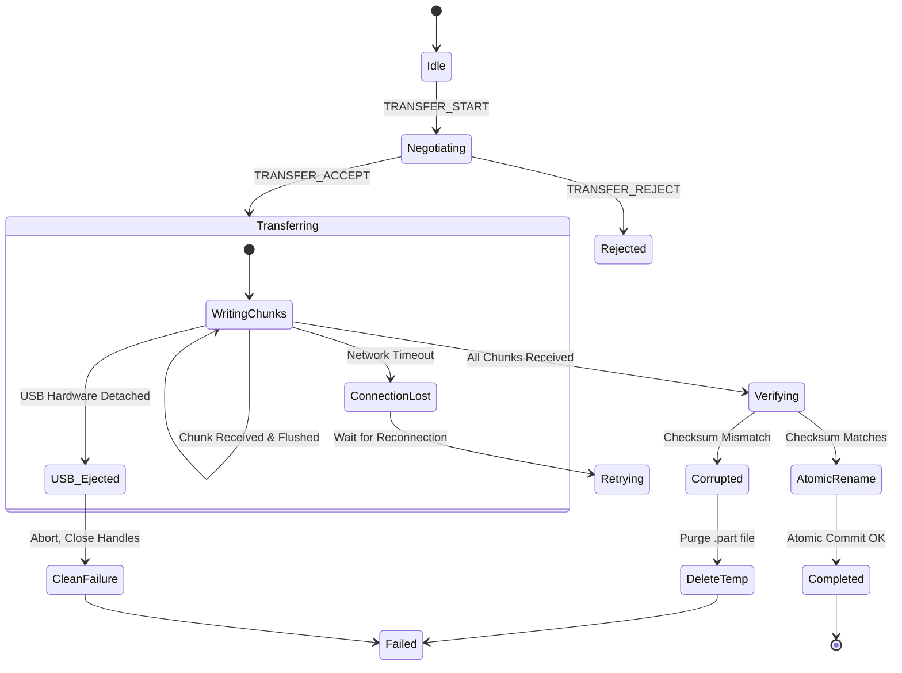

# PhoneToUSB File Transfer Protocol Specification

## 1. Transfer Philosophy

The file transfer system is designed for **maximum reliability, bounded memory usage, and zero data corruption** over unpredictable cellular and Wi-Fi connections:
1. **Streaming Chunks**: Large files are streamed in chunks (default 64 KB) with bounded memory buffers. Neither the sender nor the receiver loads the complete file into RAM.
2. **Atomic Writes**: Incoming files are written to `.phonetoUSB/temp/<transfer_id>.part`. Only after the entire file is received and the SHA-256 checksum matches is the file moved to its destination path atomically.
3. **USB Integrity Guard**: The receiver verifies that the USB drive volume is writable and physically present before opening files and between chunks.
4. **Collision Handling**: Supports rename (`file (1).ext`), overwrite, or skip modes.

---

## 2. Protocol Frame Format

Transfers operate over WebRTC DataChannel (binary mode or framed JSON + binary payload). Each transfer has a unique `transfer_id` (UUIDv4).

### 2.1 Message Types

#### 1. `TRANSFER_START`
Sent by the uploader (e.g. Android phone) to initiate a transfer:
```json
{
  "type": "TRANSFER_START",
  "transfer_id": "9b1deb4d-3b7d-4bad-9bdd-2b0d7b3dcb6d",
  "direction": "UPLOAD",
  "relative_path": "Documents/Reports/Annual2026.pdf",
  "file_size": 15485760,
  "sha256": "e3b0c44298fc1c149afbf4c8996fb92427ae41e4649b934ca495991b7852b855",
  "chunk_size": 65536,
  "total_chunks": 237,
  "conflict_policy": "RENAME"
}
```

#### 2. `TRANSFER_ACCEPT` / `TRANSFER_REJECT`
Sent by the receiver to approve or deny the transfer:
```json
{
  "type": "TRANSFER_ACCEPT",
  "transfer_id": "9b1deb4d-3b7d-4bad-9bdd-2b0d7b3dcb6d",
  "allocated_temp_path": ".phonetoUSB/temp/9b1deb4d.part"
}
```
Rejection reasons: `DISK_FULL`, `USB_NOT_WRITABLE`, `PATH_FORBIDDEN`, `ALREADY_EXISTS`.

#### 3. `TRANSFER_CHUNK`
Carries file data sequentially:
- Header: `transfer_id` (UUID), `chunk_index` (uint32), `payload_length` (uint32).
- Payload: Raw binary bytes.

#### 4. `TRANSFER_ACK`
Flow control acknowledgement sent after receiving every N chunks:
```json
{
  "type": "TRANSFER_ACK",
  "transfer_id": "9b1deb4d-3b7d-4bad-9bdd-2b0d7b3dcb6d",
  "received_chunks": 50,
  "bytes_written": 3276800
}
```

#### 5. `TRANSFER_COMPLETE`
Sent by the receiver after receiving all chunks, verifying the SHA-256 checksum, flushing to disk, and renaming to final target:
```json
{
  "type": "TRANSFER_COMPLETE",
  "transfer_id": "9b1deb4d-3b7d-4bad-9bdd-2b0d7b3dcb6d",
  "final_relative_path": "Documents/Reports/Annual2026.pdf",
  "verified_sha256": "e3b0c44298fc1c149afbf4c8996fb92427ae41e4649b934ca495991b7852b855",
  "status": "SUCCESS"
}
```

#### 6. `TRANSFER_CANCEL`
Sent by either peer to cancel an active transfer. The receiver immediately deletes the incomplete `.part` file.

---

## 3. Failure Handling & USB Removal Scenarios



### Safety Rules on USB Disconnection
1. **Never write to system drive**: If the USB drive is unplugged, file writes must not fallback to `C:\`. The file descriptor raises `OSError` / `ERROR_DEVICE_NOT_CONNECTED`.
2. **Immediate Abort**: All active write queues are cancelled.
3. **Notify Client**: If the network connection is still alive, send `USB_DISCONNECTED` error frame.
4. **Clean up**: When USB is re-inserted, any leftover `.part` files in `.phonetoUSB/temp/` older than 24 hours are safely cleaned up.
