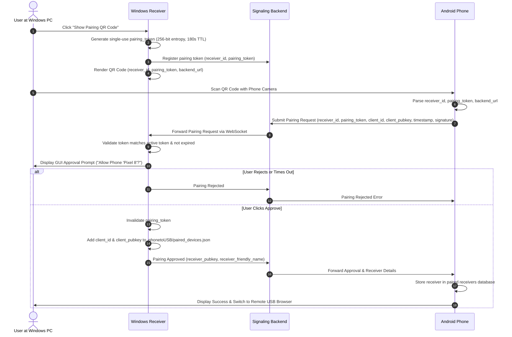

# PhoneToUSB Security Specification & Threat Model

## 1. Threat Model & Security Objectives

PhoneToUSB manages remote access to physical storage across public, untrusted networks. The security architecture adheres to zero-trust principles, meaning:
1. **The Internet signaling backend is treated as an untrusted broker.** It must not be capable of injecting false receivers, reading file contents, or forging pairing approvals.
2. **Every session must be mutually authenticated and cryptographically bound** to the long-term identities of the paired devices.
3. **The Windows Receiver enforces all filesystem authorization boundaries.** No client request is ever trusted without server-side validation.
4. **Physical removable media boundaries must be strictly contained.** No access to the host computer's OS files, internal drives, or user profile directories is permitted.

---

## 2. Threat Analysis & Mitigations

| Threat | Description | Mitigation Strategy |
| :--- | :--- | :--- |
| **Signaling Eavesdropping** | Attacker intercepts messages routed via the coordination server. | All signaling uses TLS 1.3. WebRTC DataChannels are encrypted using DTLS. Furthermore, application-level mutual auth is verified over the DataChannel. |
| **Signaling Server Impersonation / MitM** | A compromised backend attempts to substitute an attacker's receiver. | End-to-end cryptographic binding. The Android app checks the receiver's Ed25519 public key signature during handshake against its pinned paired public key. |
| **Replay Attacks** | Attacker records past pairing or connection messages and replays them. | Cryptographic nonces (fresh random 256-bit challenges) and short timestamp expiration (60 seconds) are included in every signature payload. |
| **Directory Traversal** | Remote attacker requests paths like `../../Windows/System32/cmd.exe` or `C:\Users\Admin`. | Receiver strictly normalizes target paths against the USB user root (`user_data/`). Resolving outside the root or using `..`, drive letters, or NTFS alternate streams triggers an immediate `SECURITY_VIOLATION` error and disconnects the session. |
| **Silent USB Removal / Write Redirection** | Attacker or accidental unplug causes files to be written to host OS disk. | USB volume detector verifies drive presence and filesystem root before opening any write streams. If volume is missing or unmounted, writes fail immediately. No fallback to host drives. |
| **Denial of Service / Brute Force Pairing** | Attacker spams pairing attempts to guess tokens or exhaust resources. | In-memory token expiration (3 minutes), single-use invalidation, strict rate limiting per IP / receiver ID, and explicit physical user confirmation required on the Windows PC screen. |
| **Physical USB Theft / Loss** | USB flash drive is lost or stolen. | Receiver private keys and configuration are stored in `.phonetoUSB/`. Physical security recommendation: BitLocker To Go or optional receiver master passphrase encrypting `.phonetoUSB/identity.json` with Argon2id + AES-256-GCM. |

---

## 3. Cryptographic Identity Architecture

### 3.1 Device Identity Generation
- **Algorithm**: Ed25519 (Edwards-curve Digital Signature Algorithm, RFC 8032) or ECDSA P-256.
- **Android Device**:
  - Generated upon first app launch.
  - Stored inside hardware-backed **Android Keystore** with `PURPOSE_SIGN` and `PURPOSE_VERIFY`.
  - Keys cannot be extracted in plaintext from the Android OS.
- **Windows Receiver**:
  - Generated on first run if `.phonetoUSB/receiver_identity.json` does not exist.
  - Generates:
    - `receiver_id`: SHA-256 hash of the public key (hex-encoded, prefixed with `p2u-rcv-`).
    - `public_key`: Ed25519 public key (Base64).
    - `private_key`: Ed25519 private key (Base64), stored with restricted Windows file ACLs.
  - Optional encryption with a user-supplied passphrase using PBKDF2/Argon2id + AES-GCM.

---

## 4. Initial Pairing Protocol



---

## 5. Session Authentication & Mutual Handshake

Once paired, whenever a connection is initiated over WebRTC DataChannel:
1. **Challenge Generation**:
   - Receiver generates `challenge_r = random_bytes(32)`.
   - Android client generates `challenge_c = random_bytes(32)`.
2. **Mutual Exchange**:
   - Android signs `(challenge_r || receiver_id || session_nonce)` using its Keystore private key and sends `AUTH_CLIENT_RESPONSE`.
   - Receiver verifies signature against the registered `client_pubkey` in `paired_devices.json`.
   - Receiver signs `(challenge_c || client_id || session_nonce)` using its private key and sends `AUTH_RECEIVER_RESPONSE`.
   - Android verifies signature against the pinned `receiver_pubkey`.
3. **Session State**:
   - If verification succeeds on both sides, the channel state transitions to `AUTHENTICATED`.
   - If verification fails or times out within 5 seconds, the DataChannel is immediately closed and the event is logged.

---

## 6. Filesystem Security Sandbox

The Windows Receiver implements strict path sanitization:
1. **User Data Root**: Default directory is `<USB_DRIVE_LETTER>:\` or `<USB_DRIVE_LETTER>:\PhoneToUSB_Data\`.
2. **Forbidden Names**: Reserved Windows filenames are rejected (`CON`, `PRN`, `AUX`, `NUL`, `COM1-9`, `LPT1-9`).
3. **Reserved System Paths**: Any access to the following is permanently blocked:
   - `.phonetoUSB/`
   - `PhoneToUSB.exe`
   - `.git/` or system hidden folders
4. **Traversal Prevention**:
   ```python
   def sanitize_and_resolve_path(user_relative_path: str, root_dir: Path) -> Path:
       clean_rel = os.path.normpath(user_relative_path).lstrip(r"\/")
       resolved = (root_dir / clean_rel).resolve()
       if not resolved.is_relative_to(root_dir.resolve()):
           raise SecurityViolation("Path traversal attempt detected")
       return resolved
   ```
